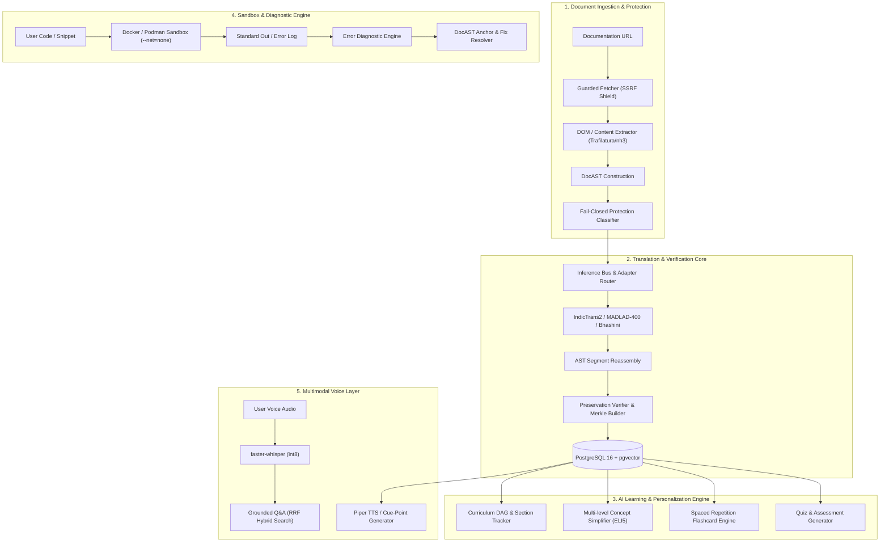

# OpenDocs Voice & Learning Engine — Backend

> **A high-assurance, code-safe, multimodal open-source documentation assistant and AI-powered personalized learning platform.**

---

## 1. System Overview & Problem Statement

Most open-source project documentation is written in English and is dense, technical, and difficult for non-native readers, beginners, and students. Generic machine translation often breaks terminal commands, package names, code blocks, and technical terms—corrupting actionable instructions and preventing capable developers from contributing. Furthermore, static documentation lacks interactivity, contextual error diagnostics, and progress-driven learning tools.

**OpenDocs Backend** solves this by establishing a zero-trust, verified architecture:
1. **Provably Code-Safe Multilingual Translation:** Translates documentation into Indian languages (Kannada, Hindi) and international languages without ever corrupting code syntax, CLI commands, package names, or file paths.
2. **Interactive AI Learning Mode:** Dynamically transforms arbitrary documentation into grounded flashcards, interactive multi-choice quizzes, simplified conceptual explanations, and an adaptive reading curriculum.
3. **Isolated Code Execution & Error Diagnosis:** Safely runs code examples inside a hardened, network-isolated sandbox and diagnoses runtime errors against the page's canonical documentation.
4. **Continuous Upstream Monitoring:** Tracks live documentation sources, diffs AST changes, and selectively invalidates stale learning progress.
5. **Multimodal Voice Accessibility:** Provides synchronized text-to-speech with sentence cue points and open-source speech-to-text transcription.

---

## 2. Core Architectural Moat: Zero-Trust Code Preservation

Traditional documentation translators pass raw markdown or HTML with naive placeholders to an LLM or MT model. Models frequently drop, rename, mutate, or misplace these placeholders.

OpenDocs enforces a **Dual-Mode Protection Engine**:

```
                       Source Documentation Paragraph
                                     │
                     ┌───────────────┴───────────────┐
                     ▼                               ▼
       [Mode A: Structural Spans]        [Mode B: Lexical Spans]
       - Fenced code blocks (`pre`)     - Inline CLI commands & flags
       - Inline literals (`code`)       - Package names & versions
       - URLs, file paths, env vars     - Dotted API identifiers
                     │                               │
       Physically extracted from         Replaced with atomic sentinels:
       model payload by offset.          `⟦k12⟧` (survives tokenizer)
                     │                               │
       Byte-exact by construction.       Model translates prose context.
                     │                               │
                     └───────────────┬───────────────┘
                                     ▼
                    Deterministic Verification Engine
                                     │
        ┌────────────────────────────┼────────────────────────────┐
        ▼                            ▼                            ▼
 [Mode A Check]               [Mode B Check]             [Failure Handler]
 SHA-256 matches              1-to-1 arity &             Mangled sentinel or
 original byte-for-byte       order validation;          missing token detected
 (no model exposure)          auto-repair pass           ───────┬────────
                                                                ▼
                                                    Fail-Closed Rollback:
                                                    Revert paragraph to original
                                                    untranslated English text
```

### The Preservation Proof & Merkle Root
For every processed document, the backend constructs an immutable **Preservation Ledger**:
- Every technical span is registered with its source offset, span type, and pre-translation SHA-256 hash.
- Post-translation text is extracted and re-hashed.
- All hashes are sorted into a binary **Merkle Tree**.
- The root hash is signed using an **Ed25519 private key** belonging to the node.
- Any client, judge, or verifier can query `GET /api/documents/{id}/proof` and independently verify via `verify.py` that zero technical commands were altered.

---

## 3. End-to-End System Architecture



---

## 4. End-to-End Processing Pipeline

The backend executes an 11-stage pipeline for every ingested document:

1. **`fetch_guarded`**: Performs DNS resolution pinning, checks IP ranges against blocked private subnets (SSRF shield), enforces redirect budgets, verifies `robots.txt`, and streams raw HTML under strict byte caps.
2. **`extract_main`**: Strips boilerplates, ads, script tags, and non-content navigation using readability algorithms. Sanitizes HTML with `nh3`.
3. **`build_docast`**: Converts sanitized HTML into a hierarchical `DocAST` tree preserving headings, section paths, reading ordinals, anchor IDs, and code blocks.
4. **`classify_protection`**: Evaluates spans across three layers:
   - *Layer 1 (Structural):* DOM tags (`pre`, `code`, `kbd`, `samp`, `math`, ITS 2.0 `translate="no"`).
   - *Layer 2 (Deterministic Regex & Gazetteers):* CLI commands, flags, package names, semver strings, URLs, file paths, hashes.
   - *Layer 3 (Fail-Closed Policy):* Ambiguous spans (confidence $0.60 \le c < 0.85$) default to protected status.
5. **`segment`**: Partitions paragraphs into alternating `ProseRun` and `ProtectedSpan` sequences.
6. **`translate_runs`**: Batches prose runs through `InferenceBus` to avoid CPU overload, using IndicTrans2 (Kannada, Hindi), MADLAD-400, or verified fallback adapters. Mode A spans never touch the model.
7. **`reconstruct`**: Injects preserved Mode A spans and verifies/replaces Mode B sentinels.
8. **`verify_and_prove`**: Compares pre- and post-hashes. If any sentinel is mangled or an invariant is violated, the affected paragraph triggers a fail-closed fallback (displays pristine English original). Calculates the Merkle root and cryptographic signature.
9. **`index_and_embed`**: Splits sections into clean chunks, computes 384-dimensional dense vectors via `multilingual-e5-small`, and builds sparse full-text search indexes (`tsvector`).
10. **`synthesize_learning_nodes`**: Analyzes the `DocAST` to generate grounded flashcards, multiple-choice quizzes with distractor explanations, and a section dependency graph.
11. **`voice_cache`**: Synthesizes speech audio buffers with per-sentence character/millisecond cue points.

---

## 5. Learning Mode & Diagnostic System

### 5.1 Grounded Quiz & Flashcard Generation
- **Grounded Flashcards:** Generated directly per `section_id`. Each card contains:
  - `front`: Concept or API method name.
  - `back`: Concise explanation + minimal runnable syntax.
  - `anchor_citation`: Exact source paragraph link.
  - Exportable to Anki (`.apkg`) and Markdown.
- **Verification-Grounded Quizzes:**
  - Multiple-choice questions with 4 distinct options.
  - Distractors are generated from related concepts within the *same* document to avoid generic or hallucinated answers.
  - Every answer option includes a rationale citing the exact `para_id`.

### 5.2 Section Curriculum DAG
The backend automatically analyzes document hierarchy and code prerequisites to construct a Directed Acyclic Graph (DAG) of sections:
- Identifies prerequisite sections (e.g., "Prerequisites" $\rightarrow$ "Installation" $\rightarrow$ "Quickstart" $\rightarrow$ "Advanced Configuration").
- Tracks user completion state (`unvisited`, `reading`, `completed`, `stale`).
- Provides `GET /api/documents/{id}/curriculum/next` to recommend the next logical section based on past quiz scores and read status.

### 5.3 Isolated Code Sandbox & Error Diagnosis
To safely evaluate user code and diagnose terminal/script errors:
- **Sandbox Architecture:**
  - Executes inside a rootless ephemeral container.
  - Network isolation: `--net=none`.
  - Resource constraints: 256 MB RAM limit, 0.5 CPU core cap, 64 PIDs limit, 5-second hard execution watchdog.
  - Read-only filesystem with a 16 MB in-memory `/tmp`.
- **Diagnostic Engine:**
  - Ingests stderr stack traces and CLI error strings.
  - Extracts error primitives (e.g., `ModuleNotFoundError: No module named 'requests'`).
  - Queries document vector chunks and the page's canonical `protected_span` registry.
  - Recommends the exact command or syntax fix cited directly from the author's documentation.

---

## 6. Database Schema (PostgreSQL 16 + pgvector)

```sql
CREATE EXTENSION IF NOT EXISTS vector;
CREATE EXTENSION IF NOT EXISTS pg_trgm;

-- Ingested Documentation Units
CREATE TABLE document (
    id UUID PRIMARY KEY DEFAULT gen_random_uuid(),
    url TEXT NOT NULL,
    url_hash TEXT NOT NULL,
    title TEXT,
    host TEXT,
    source_lang TEXT DEFAULT 'en',
    content_sha256 TEXT NOT NULL,
    status TEXT NOT NULL, -- queued|fetching|extracting|translating|verifying|ready|failed
    fetch_ms INT,
    extract_ms INT,
    translate_ms INT,
    verify_ms INT,
    created_at TIMESTAMPTZ DEFAULT now()
);
CREATE INDEX idx_document_url_hash ON document(url_hash);

-- Document Sections & Structural Hierarchy
CREATE TABLE section (
    id BIGSERIAL PRIMARY KEY,
    doc_id UUID REFERENCES document(id) ON DELETE CASCADE,
    heading TEXT,
    anchor TEXT,
    order_index INT NOT NULL,
    prerequisite_section_ids BIGINT[] DEFAULT '{}'
);

-- Aligned Paragraphs (Bilingual)
CREATE TABLE paragraph (
    id UUID PRIMARY KEY DEFAULT gen_random_uuid(),
    doc_id UUID REFERENCES document(id) ON DELETE CASCADE,
    section_id BIGINT REFERENCES section(id) ON DELETE CASCADE,
    order_index INT NOT NULL,
    original_text TEXT NOT NULL,
    original_sha TEXT NOT NULL,
    translated_text TEXT,
    target_lang TEXT,
    status TEXT NOT NULL, -- verified_structural|verified_exact|verified_after_repair|fallback_original
    proof JSONB,
    tts_cue_points JSONB
);
CREATE UNIQUE INDEX idx_para_order ON paragraph(doc_id, order_index, target_lang);

-- The Verification & Preservation Ledger
CREATE TABLE protected_span (
    id BIGSERIAL PRIMARY KEY,
    doc_id UUID REFERENCES document(id) ON DELETE CASCADE,
    para_id UUID REFERENCES paragraph(id) ON DELETE CASCADE,
    span_type TEXT NOT NULL,
    mode TEXT NOT NULL, -- 'A' (structural) | 'B' (lexical)
    original TEXT NOT NULL,
    sha256 TEXT NOT NULL,
    start_offset INT,
    end_offset INT,
    present INT DEFAULT 1,
    repaired BOOLEAN DEFAULT false,
    status TEXT NOT NULL
);
CREATE INDEX idx_protected_span_doc ON protected_span(doc_id, status);

-- Cryptographic Merkle Proof Runs
CREATE TABLE proof_run (
    id BIGSERIAL PRIMARY KEY,
    doc_id UUID REFERENCES document(id) ON DELETE CASCADE,
    target_lang TEXT NOT NULL,
    total_spans INT NOT NULL,
    mode_a INT NOT NULL,
    mode_b INT NOT NULL,
    mode_b_repaired INT NOT NULL,
    failed INT NOT NULL,
    merkle_root TEXT NOT NULL,
    signature TEXT NOT NULL,
    created_at TIMESTAMPTZ DEFAULT now()
);

-- Vector Search & Retrieval Embeddings
CREATE TABLE qa_chunk (
    id BIGSERIAL PRIMARY KEY,
    doc_id UUID REFERENCES document(id) ON DELETE CASCADE,
    para_id UUID REFERENCES paragraph(id) ON DELETE CASCADE,
    section_path TEXT[],
    text TEXT NOT NULL,
    tsv TSVECTOR,
    embedding VECTOR(384)
);
CREATE INDEX idx_qa_chunk_embedding ON qa_chunk USING hnsw (embedding vector_cosine_ops);
CREATE INDEX idx_qa_chunk_tsv ON qa_chunk USING gin(tsv);

-- Learning Mode: Flashcards
CREATE TABLE flashcard (
    id UUID PRIMARY KEY DEFAULT gen_random_uuid(),
    doc_id UUID REFERENCES document(id) ON DELETE CASCADE,
    section_id BIGINT REFERENCES section(id) ON DELETE CASCADE,
    front TEXT NOT NULL,
    back TEXT NOT NULL,
    code_snippet TEXT,
    target_lang TEXT DEFAULT 'en',
    created_at TIMESTAMPTZ DEFAULT now()
);

-- Learning Mode: Quizzes & Assessment
CREATE TABLE quiz (
    id UUID PRIMARY KEY DEFAULT gen_random_uuid(),
    doc_id UUID REFERENCES document(id) ON DELETE CASCADE,
    section_id BIGINT REFERENCES section(id) ON DELETE CASCADE,
    question TEXT NOT NULL,
    options JSONB NOT NULL,
    correct_index SMALLINT NOT NULL,
    explanation TEXT NOT NULL,
    cited_para_id UUID REFERENCES paragraph(id),
    created_at TIMESTAMPTZ DEFAULT now()
);

-- Persistent Cross-Device Learner Profiles
CREATE TABLE user_learning_profile (
    id UUID PRIMARY KEY DEFAULT gen_random_uuid(),
    user_token TEXT UNIQUE NOT NULL,
    created_at TIMESTAMPTZ DEFAULT now()
);

-- Section Mastery & Progression State
CREATE TABLE section_progress (
    user_id UUID REFERENCES user_learning_profile(id) ON DELETE CASCADE,
    doc_id UUID REFERENCES document(id) ON DELETE CASCADE,
    section_id BIGINT REFERENCES section(id) ON DELETE CASCADE,
    status TEXT CHECK (status IN ('unvisited', 'reading', 'completed', 'stale')),
    quiz_score NUMERIC(3,2),
    completed_at TIMESTAMPTZ,
    PRIMARY KEY (user_id, section_id)
);

-- Live Upstream Monitored Sources
CREATE TABLE monitored_source (
    id UUID PRIMARY KEY DEFAULT gen_random_uuid(),
    doc_id UUID REFERENCES document(id) ON DELETE CASCADE,
    url TEXT NOT NULL,
    etag TEXT,
    last_modified TEXT,
    content_hash TEXT,
    last_checked_at TIMESTAMPTZ DEFAULT now(),
    is_active BOOLEAN DEFAULT true
);
```

---

## 7. Backend API Specification

### Ingestion & Documents
| Method | Endpoint | Description |
|---|---|---|
| `POST` | `/api/documents` | Accepts `{ "url": "https://..." }`, runs guarded fetch, returns `202 Accepted` with `job_id`. |
| `GET` | `/api/jobs/{id}/events` | SSE stream yielding real-time processing milestones (`fetch`, `extract`, `translate`, `verify`). |
| `GET` | `/api/documents/{id}` | Ingestion metadata, section tree, word counts, and language coverage. |
| `GET` | `/api/documents/{id}/content?lang=kn` | Aligned bilingual text nodes, anchors, proof badges, and TTS cue points. |
| `POST` | `/api/documents/{id}/translate` | Dispatches translation job for a new target language (`kn`, `hi`, `de`, `ar`). |

### Verification & Trust
| Method | Endpoint | Description |
|---|---|---|
| `GET` | `/api/documents/{id}/proof?lang=kn` | Returns full Preservation Ledger, span counts, Merkle tree root, and Ed25519 signature. |
| `GET` | `/api/proof.pub` | Node's Ed25519 public key and standalone CLI verification script (`verify.py`). |
| `GET` | `/api/metrics` | Global system accuracy: % spans preserved, Mode A/B ratios, fail-closed count. |
| `GET` | `/api/models/manifest` | Model provenance: architecture, weights SHA-256, parameter size, licenses (Apache-2.0 / MIT). |

### Learning Mode & Progression
| Method | Endpoint | Description |
|---|---|---|
| `GET` | `/api/documents/{id}/flashcards?lang=kn` | Returns generated flashcard deck for the document. |
| `GET` | `/api/documents/{id}/flashcards/export?format=anki` | Exports deck as a compiled `.apkg` or Markdown file. |
| `GET` | `/api/documents/{id}/quizzes?section_id={id}` | Returns grounded multiple-choice questions for a specific section. |
| `POST` | `/api/quizzes/{id}/evaluate` | Submits `{ "selected_index": 2 }`, returns correctness and grounded explanation. |
| `POST` | `/api/documents/{id}/explain` | Returns multi-level conceptual explanation (`eli5`, `beginner_dev`, `deep_dive`). |
| `GET` | `/api/users/{token}/progress?doc_id={id}` | Returns completion status across the section DAG. |
| `POST` | `/api/users/{token}/progress` | Updates section status (`reading`, `completed`) and records quiz scores. |
| `GET` | `/api/documents/{id}/curriculum/next` | Returns the next recommended section based on user mastery. |

### Code Sandbox & Error Diagnosis
| Method | Endpoint | Description |
|---|---|---|
| `POST` | `/api/sandbox/run` | Executes snippet inside ephemeral isolated container (`--net=none`), returns stdout/stderr. |
| `POST` | `/api/diagnostics/error` | Ingests runtime error logs, matches against doc anchors, and returns grounded solutions. |

### Grounded Q&A & Audio
| Method | Endpoint | Description |
|---|---|---|
| `POST` | `/api/qa` | Natural language question query; responds with grounded answer, source citations, and command validation. |
| `POST` | `/api/speech/transcribe` | Ingests WAV/MP3 audio, executes Whisper `int8`, returns transcribed text and confidence. |
| `POST` | `/api/tts` | Synthesizes target language audio with word/sentence boundary timestamps. |

---

## 8. Security & Threat Model

```
                    Incoming Request
                           │
                           ▼
          [1. SSRF & Host Validation Shield]
          - Rejects 127.0.0.0/8, 10.0.0.0/8, 172.16.0.0/12, 192.168.0.0/16
          - Rejects 169.254.169.254 (Cloud Instance Metadata Service)
          - Resolves DNS hostname once; pins socket IP to prevent DNS rebinding
          - Enforces 8.0-second socket timeout and 5 MB maximum body stream
                           │
                           ▼
          [2. Prompt Injection Quarantine]
          - Extracted document text is treated as strictly passive untrusted data
          - Enclosed in bounded XML markers (`<doc_context>`)
          - Command-in-Answer Gate: Rejects any LLM answer proposing shell commands
            that do not exist in the source document's registered spans
                           │
                           ▼
          [3. Ephemeral Sandbox Hardening]
          - Container execution flags: `--net=none --pids-limit=64 --memory=256m`
          - Read-only root filesystem with no-exec temporary mount
          - Subprocess execution timeout: 5.0 seconds hard ceiling
```

---

## 9. Repository Structure

```
opendocs-backend/
├── app/
│   ├── api/                     # REST & SSE Route Handlers
│   │   ├── documents.py         # Ingestion, status, aligned content
│   │   ├── proof.py             # Preservation ledger, Merkle root, public key
│   │   ├── learning.py          # Quizzes, flashcards, explanations, curriculum
│   │   ├── sandbox.py           # Container code execution & error diagnosis
│   │   ├── qa.py                # Grounded retrieval & question answering
│   │   └── speech.py            # Whisper ASR and Piper TTS integration
│   ├── core/                    # Core Algorithms & Protection Engine
│   │   ├── docast.py            # Hierarchical Document AST definition
│   │   ├── protection.py        # Mode A/B classifier & gazetteer matchers
│   │   ├── segment.py           # Prose segmentation & reconstruction
│   │   ├── proof.py             # Merkle tree calculation & Ed25519 signing
│   │   └── bus.py               # Memory-aware InferenceBus scheduler
│   ├── adapters/                # Model Adapters (Local & Fallback)
│   │   ├── base.py              # Abstract Model Interface
│   │   ├── indictrans2.py       # IndicTrans2 CTranslate2 int8 adapter
│   │   ├── madlad.py            # MADLAD-400 Apache-2.0 adapter
│   │   ├── whisper.py           # faster-whisper int8 adapter
│   │   └── sandbox_runner.py    # Docker rootless container execution client
│   ├── models/                  # SQLAlchemy ORM Models & Migrations
│   │   └── schema.py            # Database tables & Vector definitions
│   └── services/                # Business Logic Services
│       ├── fetch_guard.py       # SSRF shield & streaming downloader
│       ├── extract.py           # Trafilatura / nh3 HTML extraction
│       ├── diagnostics.py       # Error log parser & grounded fix resolver
│       └── monitor.py           # Upstream ETag polling & AST diff engine
├── bench/                       # Benchmarking & Golden Fixtures
│   ├── corpus/                  # 50 real-world open-source doc pages
│   ├── harness.py               # Automated preservation fuzzer
│   └── report.py                # Metrics summary generator
├── docker/
│   ├── Dockerfile.api           # FastAPI backend server
│   ├── Dockerfile.worker        # Pipeline background worker
│   ├── Dockerfile.sandbox       # Minimal execution sandbox image
│   └── compose.yml              # Local composition with Postgres + pgvector
├── tests/                       # Test Suites
│   ├── test_invariants.py       # Hypothesis property tests for code preservation
│   ├── test_ssrf.py             # SSRF & IP evasion security unit tests
│   └── test_api.py              # Contract tests for all endpoints
├── pyproject.toml               # Poetry / Pip dependencies
└── README.md                    # Project documentation
```

---

## 10. Development & Implementation Roadmap

| Phase | Milestone | Deliverables |
|---|---|---|
| **Phase 1** | **Ingestion, AST & Moat** | SSRF Guard, `DocAST` tree builder, Mode A/B Protection Classifier, IndicTrans2 translation integration, Merkle Ledger & Ed25519 signature generator. |
| **Phase 2** | **AI Learning Engine** | Grounded Flashcard Generator (with `.apkg` export), Grounded Quiz Evaluator, Multi-Level Explainer (ELI5), Section Curriculum DAG & Progress Tracker. |
| **Phase 3** | **Sandbox & Diagnostics** | Isolated Docker sandbox runner (`--net=none`), Terminal/Runtime error stack trace analyzer, Grounded fix recommendation engine. |
| **Phase 4** | **Upstream Monitor & Polish** | ETag & content-hash upstream polling worker, AST diffing & stale progress invalidation, faster-whisper ASR & TTS cue points, Benchmark runner (`python -m bench.harness`). |

---

## 11. Quickstart (Backend Service)

### Prerequisites
- Python 3.11+
- Docker Engine & Docker Compose
- PostgreSQL 16 with `pgvector`

### Environment Setup
```bash
# Clone the repository
git clone https://github.com/Bhuvan-esh/OpenDoc-Backend.git
cd OpenDoc-Backend

# Set up virtual environment
python -m venv .venv
source .venv/bin/activate  # On Windows: .venv\Scripts\activate

# Install dependencies
pip install -r requirements.txt

# Launch PostgreSQL with pgvector
docker compose up -d postgres

# Run database migrations
alembic upgrade head

# Start FastAPI application
uvicorn app.main:app --host 0.0.0.0 --port 8000 --reload
```

Interactive documentation will be available at:
`http://localhost:8000/docs` (Swagger UI) and `http://localhost:8000/redoc`.
